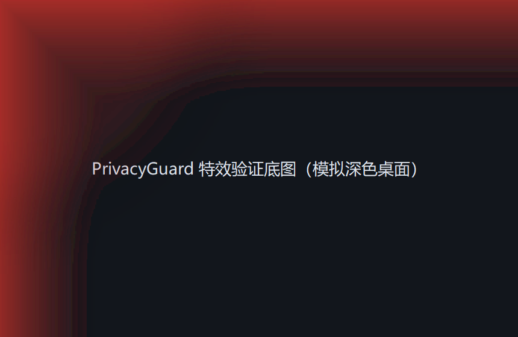
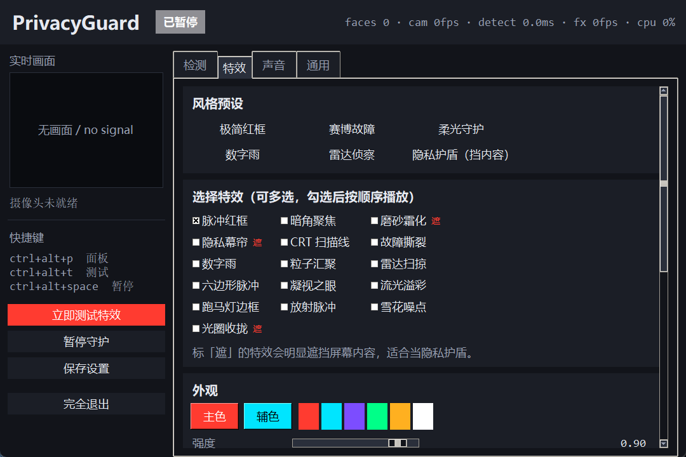
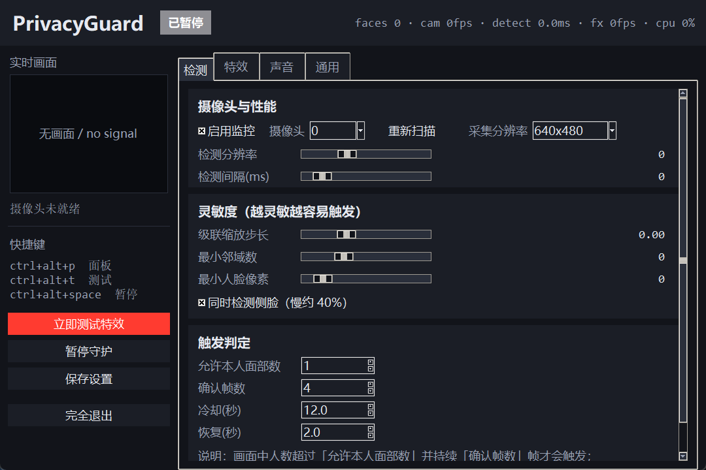
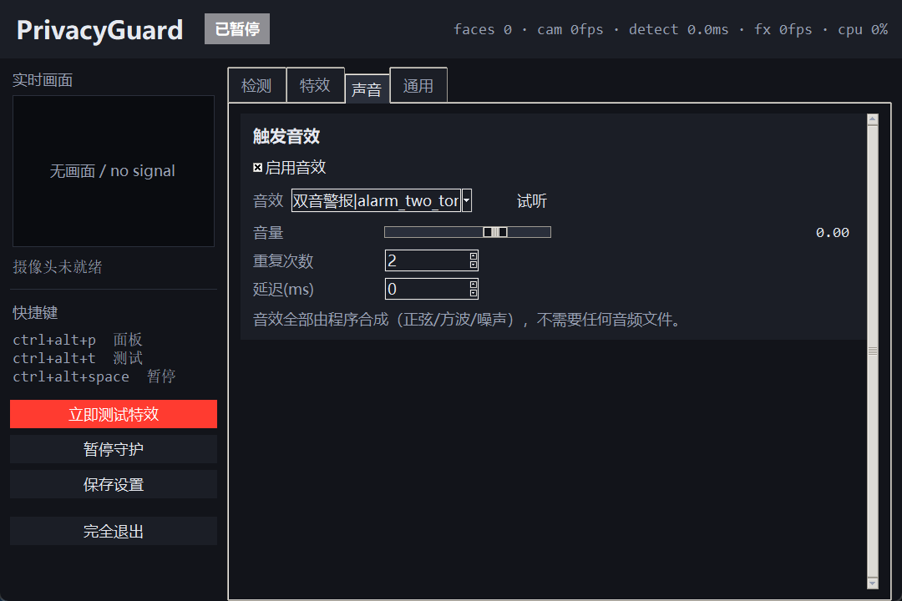
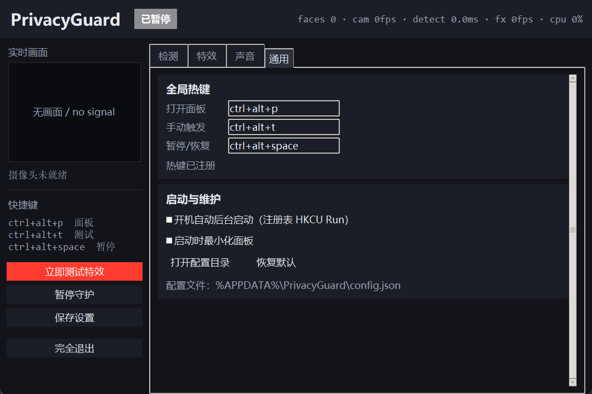
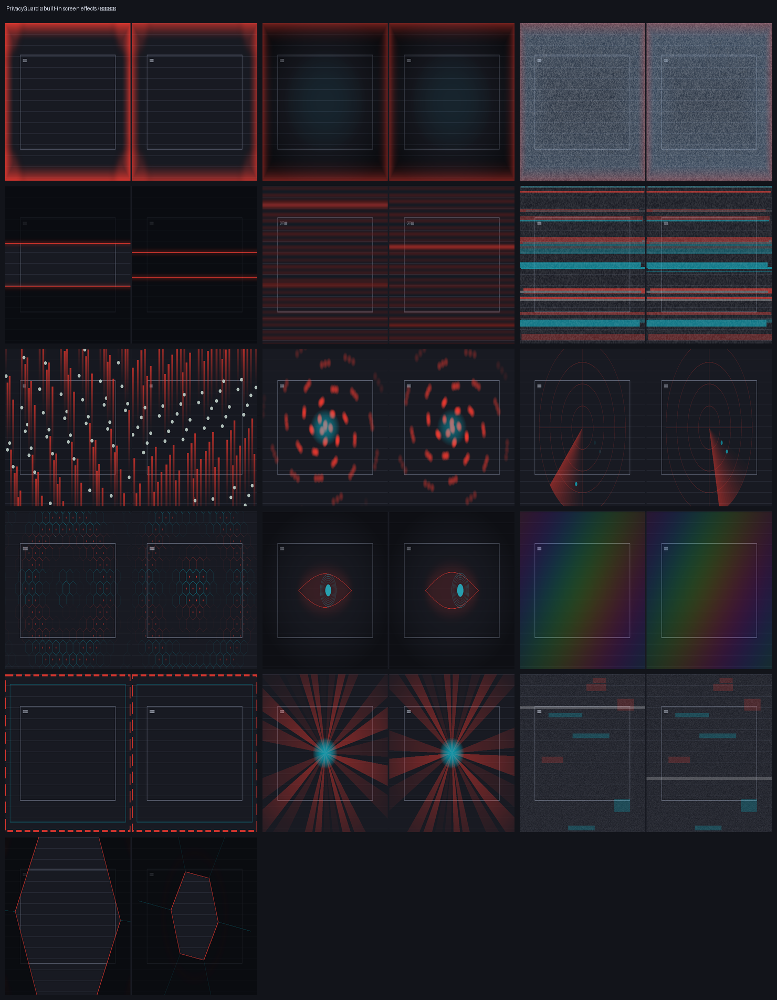
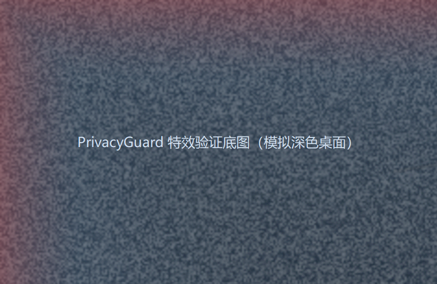
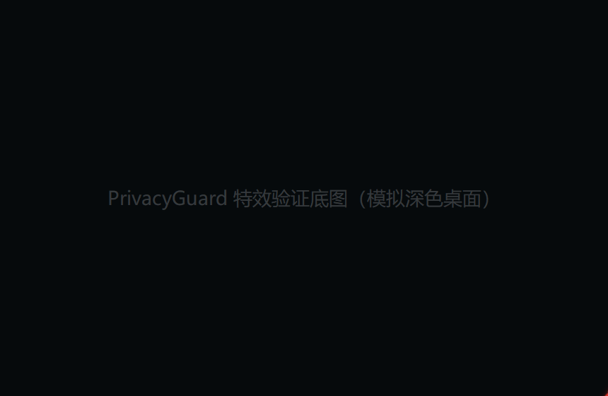

# PrivacyGuard · 摄像头看护的屏幕隐私守护

> 摄像头在后台盯着镜头前：**只要画面里出现了你以外的人**，屏幕立刻铺满一层灯光特效——不是文本框，是流动的光效；人走开后特效自己收回。
> 纯本地、不吃帧、不联网、不保存任何画面。

<p align="center">
  
  
</p>

[English README →](README_EN.md)

---

## 为什么需要它

笔记本在地铁、图书馆、共享工位上打开时，最怕的是背后有人凑上来看屏幕。
PrivacyGuard 用一枚普通摄像头做"看护"：**识别到你本人之外的第二张脸**，就用一层不遮挡操作的屏幕光效把内容糊住，让对方看不懂你在看什么，也提醒你——有人来了。

它不是截图工具，也不是录屏：**只在本机内存里做检测，帧用完即丢**。

## 特性

| | |
|---|---|
| **16 种屏幕光效** | 脉冲红框、暗角聚焦、磨砂霜化、隐私幕帘、CRT 扫描线、故障撕裂、数字雨、粒子汇聚、雷达扫掠、六边形脉冲、凝视之眼、流光溢彩、跑马灯边框、放射脉冲、雪花噪点、光圈收拢 |
| **可多选轮播** | 勾选任意组合，按顺序每 `2.5s` 切换一次，长时间警报不会看腻 |
| **控制面板** | 四个选项卡（检测 / 特效 / 声音 / 通用）：灵敏度、确认帧数、冷却、颜色、强度、透明、速度、持续时长、淡入淡出、渲染质量、预设风格、热键、开机自启 |
| **6 套预设** | 极简红框 / 赛博故障 / 柔光守护 / 数字雨 / 雷达侦察 / 隐私护盾（遮挡型） |
| **6 种合成音效** | 双音警笛、柔和铃声、心跳、气流、数字蜂鸣、上升音——全部程序合成，仓库里没有任何音频文件 |
| **点击穿透** | 覆盖层是分层窗口，鼠标、键盘、滚动全部穿透到下层，警报期间你照样能操作 |
| **多显示器** | 一张窗口覆盖整个虚拟屏，混合 DPI 也对得齐 |
| **性能** | 空闲 ≈ 13% 单核 / 约 190 MB；检测 4 ms/帧；警报期间 22–30 fps 且会自适应降采样保帧率 |

## 截图

| 检测页 | 特效页 |
|---|---|
|  |  |
| **声音页** | **通用页** |
|  |  |

特效总览（每个特效取两帧）：



真实合成效果（覆盖层叠在窗口之上拍下来的屏幕像素）：

<p>
  
  
  
</p>

## 快速开始

```powershell
# 1) 依赖（Windows 10/11 + Python 3.9-3.13）
pip install -r requirements.txt

# 2) 带控制面板启动
python -m privacyguard

# 3) 纯后台（开机自启用的就是这条命令）
python -m privacyguard --no-panel

# 4) 先看效果：启动后自动触发一次
python -m privacyguard --test 8

# 其他参数
python -m privacyguard --camera 1        # 换一个摄像头
python -m privacyguard --no-camera       # 不接摄像头，只调特效 / 调面板
python -m privacyguard --config my.json  # 用指定配置
```

> **依赖提示**：必须使用 `opencv-python==4.12.*`。OpenCV 5.x 已经不再随 wheel 分发
> Haar 级联 XML（`cv2.data.haarcascades` 是空的），装 5.x 会得到"找不到人脸模型"。
> 也可以用系统 Python（例如 `C:\...\Python311\python.exe`）——某些精简环境里的
> Python 缺少 Tcl/Tk 资源，`import tkinter` 能过但 `Tk()` 会报 `Can't find a usable init.tcl`，
> 那种环境只能跑 `--no-panel`。

## 怎么用

1. 启动后程序在后台看护，面板可以最小化甚至关掉（守护继续）。
2. 平时你一个人对着屏幕时什么都不发生——它把**画面里最大的那张脸**当作"你自己"。
3. 画面里出现第二个人（或你不允许的人数），连续 `确认帧数`（默认 4 帧 ≈ 0.4 s）确认后触发。
4. 屏幕立刻铺上特效 + 可选音效；人走开并安静 `恢复秒数`（默认 2 s）后特效淡出。
5. `冷却秒数`（默认 12 s）内不会重复触发，避免闪烁轰炸。

### 全局热键

| 热键 | 作用 |
|---|---|
| `Ctrl+Alt+P` | 呼出控制面板 |
| `Ctrl+Alt+T` | 立即触发一次特效（相当于"我被人看了"） |
| `Ctrl+Alt+Space` | 暂停 / 恢复守护 |

热键可在「通用」页改，注册失败会在页面下方提示（被别的软件占用是最常见原因）。

### 特效清单

| key | 中文 | English | 遮挡屏幕 |
|---|---|---|---|
| `pulse_frame` | 脉冲红框 | Pulse frame | |
| `vignette_focus` | 暗角聚焦 | Vignette focus | |
| `frost` | 磨砂霜化 | Frosted glass | ✅ |
| `curtain` | 隐私幕帘 | Privacy curtain | ✅ |
| `scanlines` | CRT 扫描线 | CRT scanlines | |
| `glitch` | 故障撕裂 | Glitch tear | |
| `matrix_rain` | 数字雨 | Matrix rain | |
| `particles` | 粒子汇聚 | Particle converge | |
| `radar` | 雷达扫掠 | Radar sweep | |
| `hexgrid` | 六边形脉冲 | Hex pulse grid | |
| `watch_eye` | 凝视之眼 | Watching eye | |
| `rainbow_wash` | 流光溢彩 | Rainbow wash | |
| `marquee` | 跑马灯边框 | Marquee border | |
| `sunburst` | 放射脉冲 | Sunburst | |
| `noise_static` | 雪花噪点 | Noise static | |
| `aperture` | 光圈收拢 | Iris aperture | ✅ |

标 ✅ 的三个会明显糊住内容，适合当真正的隐私护盾；其余偏"提醒"，你能看清自己在干什么。

### 配置

配置文件：`%APPDATA%\PrivacyGuard\config.json`（原子写入，手改越界值会被自动夹取）。
面板里改完点**保存设置**即可；「通用」页可开启**开机自启**（写 `HKCU\...\Run`）。

## 性能

实测环境：i7-14650HX / 16 线程 / Windows 11 / Python 3.11 / 虚拟屏 1707×1067。

| 场景 | 实测 |
|---|---|
| 空闲守护（摄像头 + 检测） | 约 **13% 单核**（≈0.8% 整机），内存 ≈ 190 MB |
| 空闲且不开摄像头 | 约 **0.8% 单核** |
| 人脸检测 | **4 ms/帧** @ 320 px 检测宽度（frontal + profile） |
| 警报渲染 | **22–30 fps**，并且会自动降分辨率以保帧率 |

为什么能这么轻：

- **三线程分离**：`camera`（15 fps 抓帧）/ `detect`（10 Hz 检测）/ `render`（仅警报期间存在）。
  空闲时窗口隐藏、渲染线程不存在，只剩采集与检测。
- **降分辨率渲染**：特效在 `quality`（默认 0.5）的画布上绘制，再放大到屏幕；像素量只有 1/4。
- **自适应**：帧耗时超过预算就先降到最近邻放大、再把渲染分辨率下调；宽裕时自动升回来。
- **零分配热路径**：`UpdateLayeredWindow` 只吃预乘 BGRA，覆盖层线程仅做 memmove，不做任何绘制。

## 已知限制

- **独占全屏的 3D 游戏**会盖住一切覆盖层（这是 DirectX 独占全屏的机制，不是 bug）。用无边框窗口化即可正常显示；此时音效仍然会响。
- 摄像头被物理遮挡 / 隐私挡板关闭时只能看到全黑画面，面板会提示"摄像头画面全黑"，不会误触。
- Haar 级联在**逆光、极暗、大角度侧脸**下会漏检；要求更稳可以自己替换成 YuNet/MediaPipe，检测器是独立模块。
- 只做"有没有第二张脸"，**不做人脸识别 / 不认身份**，也不保存任何人脸数据。

## 项目结构

```
privacyguard/
  __main__.py     CLI 入口（--no-panel / --test / --camera / --config）
  app.py          GuardService：三线程编排、触发/收尾、开机自启
  camera.py       抓帧线程 + 最新帧槽（永不积压）
  detector.py     Haar 人脸检测 + 去抖触发状态机
  overlay.py      Win32 分层覆盖层（穿透 / 置顶 / 多显示器 / 预乘 BGRA）
  effects/        特效引擎：16 个特效 + 序列器 + 绘图原语
  sound.py        程序合成音效（numpy → wav → winsound 内存播放）
  hotkeys.py      全局热键消息线程
  panel.py        tkinter 控制面板
docs/
  architecture.md 线程模型与关键实现细节
  effects/        16 张特效预览 + 图集
  screens/        面板与合成效果截图
tools/render_effects.py   重新生成特效预览
tests/                    单元测试 + 覆盖层/特效/面板验证脚本
```

## 开发

```powershell
python -m unittest discover -s tests -v   # 11 个单元测试
python tools\render_effects.py --out docs\effects   # 重出特效图集
python tests\bench_loop.py pulse_frame frost        # 实测帧率
python tests\prove_effect.py pulse_frame frost      # 把真实特效铺到屏幕上并截图
python tests\shot_panel.py               # 逐个截取面板四个页面
```

技术细节见 [docs/architecture.md](docs/architecture.md)。

## 许可

MIT —— 见 [LICENSE](LICENSE)。
