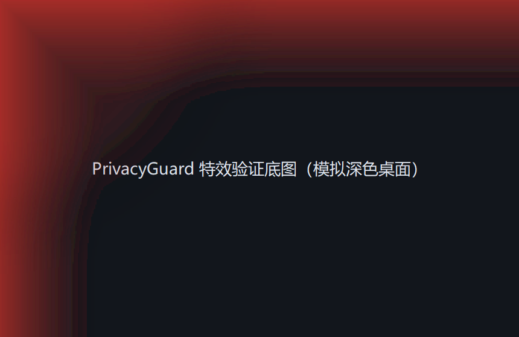
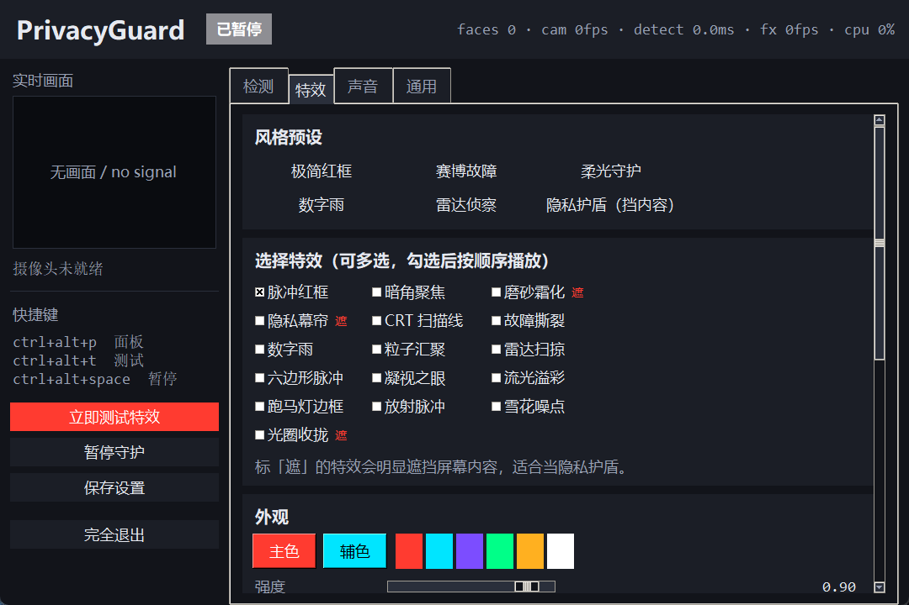
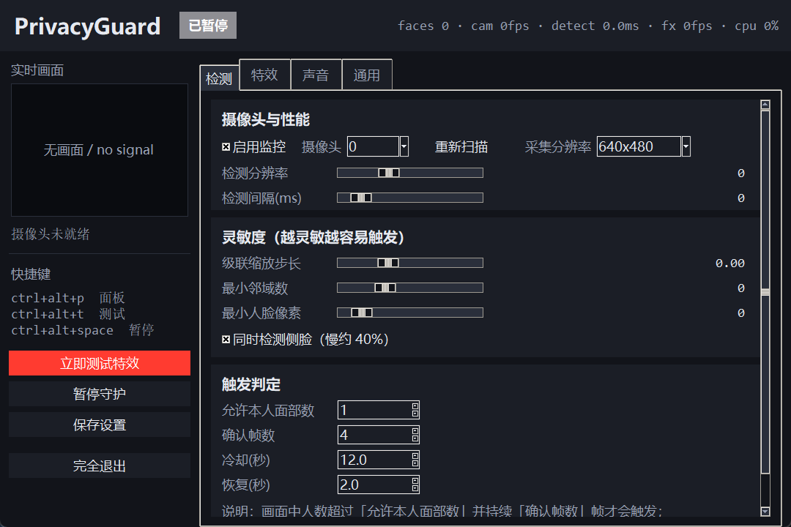
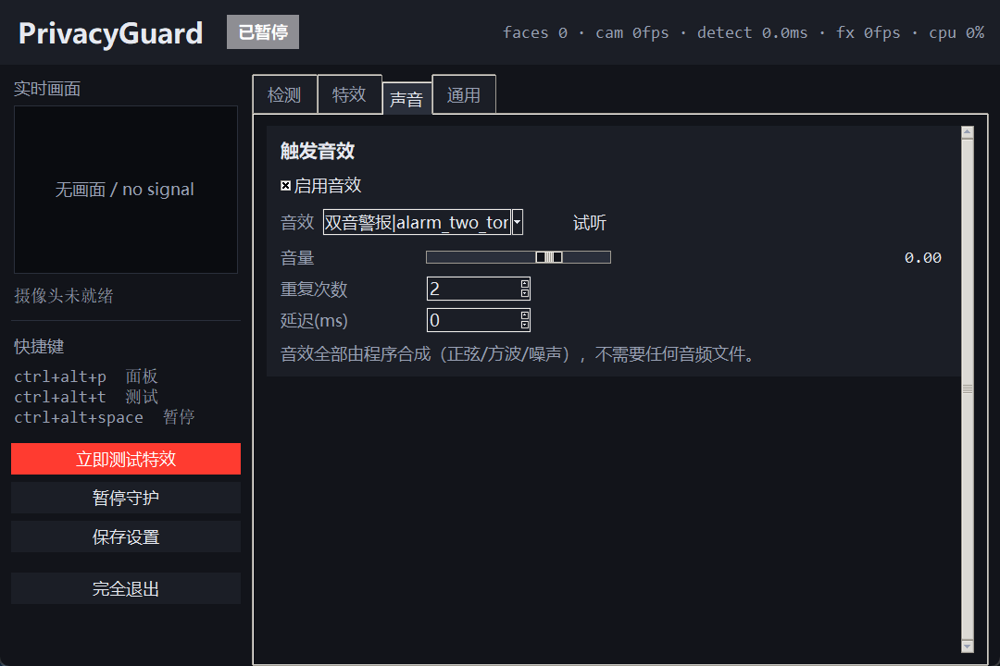
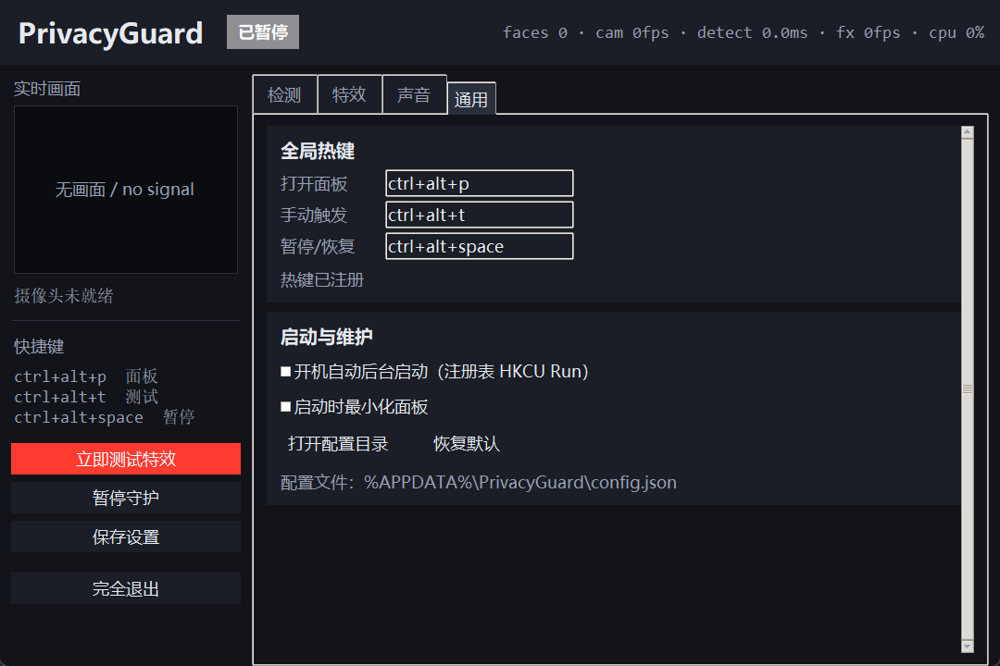
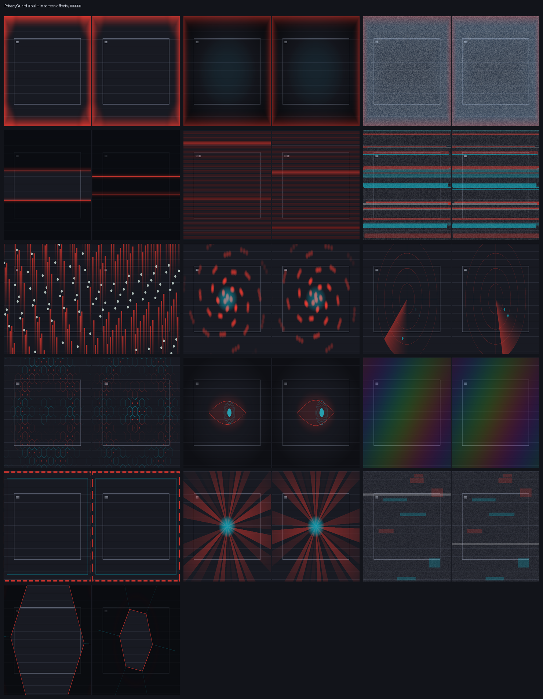
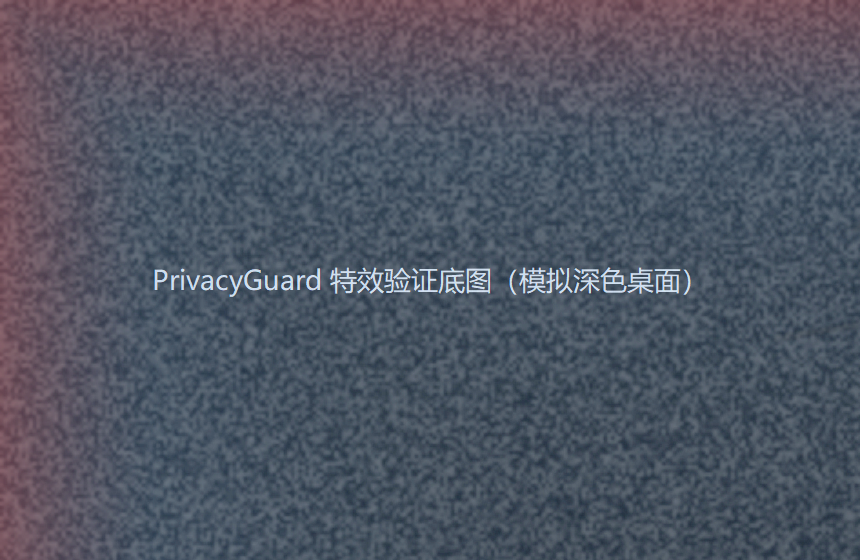
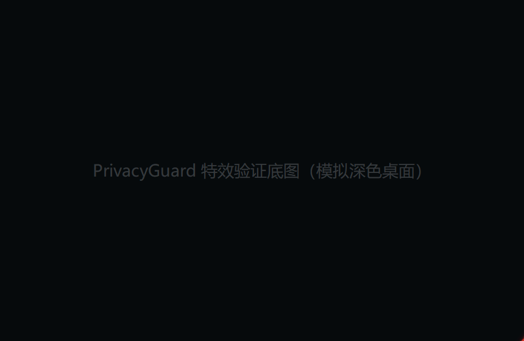

# PrivacyGuard — a camera-watched screen privacy guard

> Your webcam watches the room. **The moment a second face shows up**, the screen
> fills with animated light effects — not a text box, actual light. When they leave,
> the effects fade out by themselves.
> Fully local. No frames stored, no network, no accounts.

<p align="center">
  
  
</p>

[中文 README →](README.md)

---

## Download (no Python needed)

| File | What it is |
|---|---|
| [**PrivacyGuard.exe**](https://github.com/sg0928-new/-/releases/latest/download/PrivacyGuard.exe) | Single-file Windows 10/11 build, 65 MB — Python, Tk, OpenCV and the Haar cascades are all inside |
| [All releases](https://github.com/sg0928-new/-/releases) | Version history and release notes |

```powershell
.\PrivacyGuard.exe                 # control panel + guarding
.\PrivacyGuard.exe --no-panel      # headless (this is what autostart registers)
.\PrivacyGuard.exe --test 8        # preview the effects
```

> The build is unsigned, so SmartScreen shows "unknown publisher" on first launch —
> choose *More info → Run anyway*. To build it yourself:
> `pip install pyinstaller` then `powershell -File tools\build_exe.ps1`.

## Why

A laptop opened in a train, a library or a hot-desking office has one recurring
problem: someone standing behind you reading your screen. PrivacyGuard turns the
webcam you already have into a lookout. It treats the **largest face in frame** as
you, and as soon as another face appears it covers the screen with an animated
effect that people can read through but strangers cannot — while you keep working,
because every click passes straight through the overlay.

It is not a screenshot tool and not a recorder: detection happens in memory only and
each frame is dropped as soon as it has been used.

## Features

| | |
|---|---|
| **16 screen effects** | pulse frame, vignette focus, frosted glass, privacy curtain, CRT scanlines, glitch tear, matrix rain, particle converge, radar sweep, hex pulse grid, watching eye, rainbow wash, marquee border, sunburst, noise static, iris aperture |
| **Multi-select rotation** | tick any combination; the sequencer cycles them every `2.5s` so a long alert never looks static |
| **Control panel** | four tabs (monitor / effects / sound / general): sensitivity, confirm frames, cooldown, colours, intensity, opacity, speed, duration, fade, render quality, presets, hotkeys, autostart |
| **6 presets** | minimal red frame, cyber glitch, soft guard, matrix, radar, max shield |
| **6 synthesised sounds** | two-tone alarm, soft chime, heartbeat, whoosh, digital beep, riser — generated at runtime, the repo contains no audio files |
| **Click-through** | the overlay is a layered window: mouse, keyboard and wheel go straight to the app underneath |
| **Multi-monitor** | a single window spans the whole virtual screen, mixed DPI included |
| **Performance** | idle ≈ 13% of one core / ~190 MB; detection 4 ms/frame; alerts run at 22–30 fps with adaptive downscaling |

## Screens

| Monitor tab | Effects tab |
|---|---|
|  |  |
| **Sound tab** | **General tab** |
|  |  |

All sixteen effects, two frames each:



Composited for real (screen pixels captured while the overlay was up):

<p>
  
  
  
</p>

## Quick start

```powershell
# 1) dependencies (Windows 10/11, Python 3.9-3.13)
pip install -r requirements.txt

# 2) run with the control panel
python -m privacyguard

# 3) headless (this is what autostart registers)
python -m privacyguard --no-panel

# 4) see it immediately: fire one alert after start
python -m privacyguard --test 8

# other flags
python -m privacyguard --camera 1
python -m privacyguard --no-camera       # tune effects / panel without a camera
python -m privacyguard --config my.json
```

> **Dependency note**: pin `opencv-python==4.12.*`. OpenCV 5.x no longer ships the
> Haar cascade XMLs in its wheel (`cv2.data.haarcascades` is empty), so 5.x simply
> has no face model. Some minimal Python builds also lack the Tcl/Tk data files —
> `import tkinter` succeeds but `Tk()` raises `Can't find a usable init.tcl`; such an
> interpreter can still run `--no-panel`.

## How it behaves

1. Start it and forget it; the panel can be minimised or closed, guarding continues.
2. Alone in front of the laptop, nothing happens at all.
3. A second face (or more faces than you allow) must persist for `confirm_frames`
   frames (default 4 ≈ 0.4 s) before the alert fires — no single-frame misfires.
4. Effects (and optionally a sound) cover the screen; once the room is clear for
   `release_s` (default 2 s) they fade out.
5. For `cooldown_s` (default 12 s) it will not re-trigger, so the screen never strobes.

### Hotkeys

| Hotkey | Action |
|---|---|
| `Ctrl+Alt+P` | show the control panel |
| `Ctrl+Alt+T` | trigger one alert manually |
| `Ctrl+Alt+Space` | pause / resume guarding |

They are editable on the General tab; a registration failure is reported there
(another application owning the combo is the usual cause).

### Effects

| key | English | 中文 | Hides content |
|---|---|---|---|
| `pulse_frame` | Pulse frame | 脉冲红框 | |
| `vignette_focus` | Vignette focus | 暗角聚焦 | |
| `frost` | Frosted glass | 磨砂霜化 | ✅ |
| `curtain` | Privacy curtain | 隐私幕帘 | ✅ |
| `scanlines` | CRT scanlines | CRT 扫描线 | |
| `glitch` | Glitch tear | 故障撕裂 | |
| `matrix_rain` | Matrix rain | 数字雨 | |
| `particles` | Particle converge | 粒子汇聚 | |
| `radar` | Radar sweep | 雷达扫掠 | |
| `hexgrid` | Hex pulse grid | 六边形脉冲 | |
| `watch_eye` | Watching eye | 凝视之眼 | |
| `rainbow_wash` | Rainbow wash | 流光溢彩 | |
| `marquee` | Marquee border | 跑马灯边框 | |
| `sunburst` | Sunburst | 放射脉冲 | |
| `noise_static` | Noise static | 雪花噪点 | |
| `aperture` | Iris aperture | 光圈收拢 | ✅ |

The three ✅ effects genuinely hide what is on screen; the rest are "attention"
effects you can still read through.

### Configuration

`%APPDATA%\PrivacyGuard\config.json` — written atomically, out-of-range values are
clamped on load. Change things in the panel and press **save**. Autostart (HKCU Run)
lives on the General tab.

## Performance

Measured on i7-14650HX / 16 threads / Windows 11 / Python 3.11 / 1707×1067 virtual screen:

| Scenario | Measured |
|---|---|
| Idle guarding (camera + detection) | ≈ **13% of one core** (≈0.8% of the machine), ≈190 MB RSS |
| Idle without a camera | ≈ **0.8% of one core** |
| Face detection | **4 ms/frame** at 320 px working width (frontal + profile) |
| Alert rendering | **22–30 fps**, with adaptive downscaling on weaker CPUs |

Where the head-room comes from:

- **Three decoupled threads**: `camera` (15 fps grabs), `detect` (10 Hz), `render`
  (exists only during an alert). Idle means hidden window and no render thread.
- **Reduced-resolution rendering**: effects draw at `quality` (default 0.5) and are
  scaled up — a quarter of the pixels.
- **Adaptive fallback**: when a frame blows the budget it switches to nearest-neighbour
  upscaling, then lowers the render resolution; it climbs back when there is room.
- **Zero-allocation hot path**: `UpdateLayeredWindow` takes premultiplied BGRA; the
  overlay thread only memmoves, it never draws.

## Known limitations

- **Exclusive-fullscreen 3D games** cover every overlay window (that is how DirectX
  exclusive mode works, not a bug). Use borderless windowed mode and the overlay shows
  normally; sound still plays either way.
- A physically blocked webcam (privacy shutter, tape) yields an all-black frame; the
  panel says so instead of false-triggering.
- Haar cascades miss faces under strong back-light, near darkness or extreme angles.
  The detector is a separate module, so swapping in YuNet/MediaPipe is straightforward.
- It only asks "is there a second face" — **no face recognition, no identity, no stored
  face data**.

## Layout

```
privacyguard/
  __main__.py     CLI (--no-panel / --test / --camera / --config)
  app.py          GuardService: threads, trigger/release, autostart
  camera.py       capture thread with a latest-frame slot (never backs up)
  detector.py     Haar detection + debounced trigger state machine
  overlay.py      Win32 layered overlay (click-through, topmost, virtual screen)
  effects/        16 effects + sequencer + drawing primitives
  sound.py        synthesised sounds (numpy -> wav -> winsound from memory)
  hotkeys.py      global hotkey message thread
  panel.py        tkinter control panel
docs/
  architecture.md threading model and implementation notes
  effects/        16 previews + contact sheet
  screens/        panel and composited screenshots
tools/render_effects.py   regenerate the previews
tests/                    unit tests + overlay/effect/panel verification scripts
```

## Development

```powershell
python -m unittest discover -s tests -v            # 11 unit tests
python tools\render_effects.py --out docs\effects  # regenerate the gallery
python tests\bench_loop.py pulse_frame frost       # measure fps
python tests\prove_effect.py pulse_frame frost     # composite real effects, then screenshot
python tests\shot_panel.py                         # screenshot each panel tab
```

Implementation notes: [docs/architecture.md](docs/architecture.md).

## License

MIT — see [LICENSE](LICENSE).
